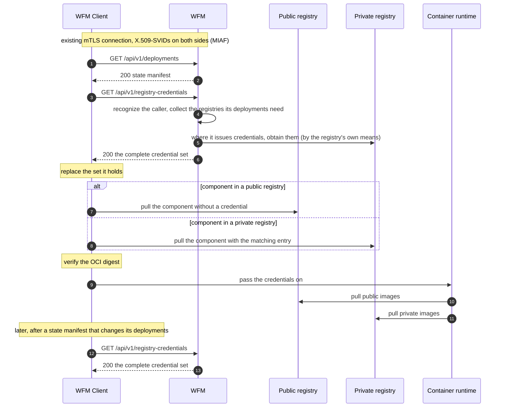

# Specification Update Proposal: Registry access through MIAF

## Owner

@Beckhoff-PaulH

## Summary

A WFM Client obtains registry credentials for pulling, each with an expiry, from its own WFM, over
the Management Interface connection it already has. The WFM authenticates the caller with MIAF as
on every call and answers with a username, a secret and an expiry for each private registry the
caller's deployments need. Such a credential can be a token that the WFM had the registry issue
for this WFM Client alone: pull-only, limited to the repositories it needs, and expiring. The WFM
Client pulls a component with such a credential and passes the credential on to its container
runtime for the images. A public registry needs no entry and is pulled as today.

Every answer is the complete current set and replaces the one before it.

MIAF, the WFM Identity Profile and the desired-state documents are not changed.

## Reason for proposal

The specification defines what a device pulls and how it checks the bytes of a Compose Archive
(the OCI digest), but not how the device proves that it may pull.

- Today a device pulls from a public registry on its own. For a private registry a person has to
  log in on every device, or an implementation supports anonymous registries only. The same
  deployment succeeds on one conformant device and fails on another.
- A credential typed in on a device has no expiry, cannot be revoked from the WFM and is invisible
  to the operator.
- Private registries are the normal case, also inside one organization.
- `identity-framework.md` already gives the direction: for an interface into an ecosystem with its
  own authentication convention, such as an OCI registry, a component's X.509-SVID is expected to
  serve as the root credential it uses to obtain an ecosystem-native credential, rather than as
  the wire-level authentication mechanism itself. This proposal defines that step.

## Requirements alignment acknowledgement

**Related Feature(s):**
[Issue #129 - margo/specification](https://github.com/margo/specification/issues/129), with its
sub-issues [#15](https://github.com/margo/specification/issues/15) and
[#145](https://github.com/margo/specification/issues/145).

| Acceptance criterion of #129 | Covered by |
| --- | --- |
| Standard authorization mechanisms for Helm packages, container images and Compose tar files | One answer form, a username and a secret, which the common runtimes accept (section 5) |
| How the WFM receives and manages the tenant's credentials | Proposed to be out of scope, to be agreed: left to the WFM |
| How the WFM prepares the credentials for the edge device to pull | The route (section 3) and the rules (section 4) |
| How the edge device stores the credentials | Not used after the expiry (section 3) and never in the deployment status (section 4). How it is kept until then is left to the implementation |

Proposed to be out of scope, to be agreed with the TWG:

- licensing and entitlement, i.e. who may buy or use a product. Issue #15 raised this question;
  this proposal covers the technical part of #15, how a credential reaches the device, and leaves
  entitlement to the parties;
- secrets inside a deployment (#145);
- what a registry could offer so that a WFM needs no long-lived credential of a tenant. This
  proposal asks nothing of a registry; that question can be a proposal of its own;
- artifact signing;
- federation between Trust Domains and JWT-SVID, the later stage sketched in the discussion of
  #129.

Statements about the specification refer to v1.0.0-rc.3 unless the pre-draft is named.

## Technical proposal

### 1. Scope

This proposal applies to a WFM and a WFM Client that support components from private OCI
registries. It asks nothing of a registry: every registry that accepts a username and a secret
works as it is.

No new principal, no new identity profile and no federation are introduced. The X.509-SVID is
never presented to a registry.

### 2. Terms

- **registry credential**: a username and a secret that a registry accepts for pulling, together
  with an expiry.
- **issued credential**: a registry credential that the WFM created or obtained for this purpose
  and that the registry itself stops accepting at its expiry.
- **pass-through**: the WFM hands out, unchanged, a long-lived credential the operator stored.
- **puller**: the WFM Client pulling a component (a Compose Archive, a Helm chart) from a Component
  Registry, or the container runtime pulling the images that component names.
- **repository**: one full OCI repository name on one registry host.
- **operator**: the party that runs the WFM and decides its policy.

The principal is the WFM Client. Where this text says device, it means the Edge Compute Device
that hosts the WFM Client. A WFM Client that acts as a gateway receives the set for all the
deployments it is given; how it passes credentials to devices behind it is not defined here.

### 3. Endpoint: Registry Credentials

The subsections are modelled on the State Manifest endpoint of the Desired State page.

#### Route and HTTP Methods

```https
GET /api/v1/registry-credentials
```

The route takes no parameter. The WFM answers for every private registry that the caller's
deployments need: for the components, and for the images those components refer to. The WFM Client
names nothing.

Every `200` response is the complete current credential set of the caller.

#### Request Headers

| Header | Description |
| --- | --- |
| `Accept` | *(optional)* The client SHOULD request `application/vnd.margo.registry-credentials.v1+json`. If it is omitted, the WFM defaults to that format |

Authentication is mTLS with X.509-SVIDs, as on every Management Interface route. The response is
encrypted on that connection. Where the operator runs a TLS-offloading proxy in front of the WFM,
as the Management Interface allows, the body crosses the hop between proxy and WFM; protecting
that hop is the operator's task. No additional encryption of the body is defined.

#### Response Codes

| Code | Description |
| --- | --- |
| `200 OK` | The body is the credential set. The response MUST carry `Content-Type: application/vnd.margo.registry-credentials.v1+json` and `Cache-Control: no-store` |
| `403 Forbidden` | The request is rejected by the WFM's local policy, for example because the client relationship is retired. As on the other routes the WFM SHOULD answer with the problem type `not-authorized` |
| `406 Not Acceptable` | No representation matches the `Accept` header. Problem type `server-cannot-generate-response` |
| `429 Too Many Requests` | The WFM limits the request rate. The response SHOULD carry `Retry-After`. Problem type `about:blank` |
| `404 Not Found` | The WFM does not offer the route. Problem type `about:blank` |
| `501 Not Implemented` | The WFM does not offer the route. Problem type `about:blank` |

#### Example Request

```http
GET /api/v1/registry-credentials HTTP/1.1
Host: wfm.example.com
Accept: application/vnd.margo.registry-credentials.v1+json
```

#### Example Registry Credentials Response

Two private registries, one of them with two credentials:

```http
HTTP/1.1 200 OK
Content-Type: application/vnd.margo.registry-credentials.v1+json
Cache-Control: no-store
Date: Fri, 13 Nov 2026 11:00:00 GMT

{
  "credentials": [
    {
      "registry": "registry.example.com",
      "repositories": [
        "components/feed/app-a",
        "images/feed/app-a"
      ],
      "username": "example-user",
      "secret": "example-secret",
      "expiresAt": "2026-11-13T12:00:00Z"
    },
    {
      "registry": "registry.example.com",
      "repositories": [
        "images/other-vendor"
      ],
      "username": "second-user",
      "secret": "second-secret",
      "expiresAt": "2026-11-13T12:00:00Z"
    },
    {
      "registry": "images.example.org:5000",
      "username": "another-user",
      "secret": "another-secret",
      "expiresAt": "2026-11-13T12:00:00Z"
    }
  ]
}
```

#### Example Response Without Credentials

The deployments of the caller use public registries only:

```http
HTTP/1.1 200 OK
Content-Type: application/vnd.margo.registry-credentials.v1+json
Cache-Control: no-store
Date: Fri, 13 Nov 2026 11:00:00 GMT

{
  "credentials": []
}
```

#### Example Error Responses

The caller is not accepted by the WFM's local policy:

```http
HTTP/1.1 403 Forbidden
Content-Type: application/problem+json

{
  "type": "https://docs.margo.org/specification/problem-types#not-authorized",
  "title": "Not Authorized",
  "status": 403,
  "detail": "The request is not authorized by the WFM's local policy (for example, the client relationship has been retired).",
  "instance": "/api/v1/registry-credentials"
}
```

The WFM limits the request rate:

```http
HTTP/1.1 429 Too Many Requests
Content-Type: application/problem+json
Retry-After: 60

{
  "type": "about:blank",
  "title": "Too Many Requests",
  "status": 429,
  "detail": "Rate limit exceeded. Retry after the indicated period.",
  "instance": "/api/v1/registry-credentials",
  "retryable": true,
  "backoffStrategy": "exponential"
}
```

#### Response Body Attributes

| Field | Type | Required? | Description |
| --- | --- | --- | --- |
| `credentials` | array | Y | The credential entries. An empty array if the caller needs none; it MUST NOT be omitted |
| `credentials[].registry` | string | Y | The registry host, with the port if it is not 443. Several entries MAY name the same host |
| `credentials[].repositories` | array of string | N | Repository path prefixes on that host the entry is meant for. If it is absent, the entry is meant for every repository on the host |
| `credentials[].username` | string | Y | The username to present |
| `credentials[].secret` | string | Y | The secret to present |
| `credentials[].expiresAt` | string | Y | RFC 3339 timestamp in UTC. The WFM Client MUST NOT use the entry after this instant |

A repository in a public registry has no entry.

#### Client Validation Rules

- The WFM Client MUST replace the credential set it holds with every `200` response. An entry that
  is no longer in the response MUST NOT be used any more.
- For a pull, the WFM Client MUST choose the entry whose `registry` is the host of the repository
  and whose `repositories` contains the longest path prefix of it. An entry without `repositories`
  matches every repository on its host and is the least specific.
- The WFM Client MUST NOT fail on fields it does not know.

#### Sequence Diagram

The flow for one deployment:



If the caller is not accepted, the WFM answers `403` and the WFM Client gets no credential.

### 4. Rules

These rules cover the interface: what is exchanged, what the exchanged fields mean, and what each
side does on the interface. How a WFM stores, shows or logs credentials, how it learns the
registries of the images, and whether it passes a stored credential through, are its
implementation and the operator's policy.

The WFM:

- MUST apply the recognition rules of the WFM Identity Profile to every request.
- MUST answer only for registries that the deployments of the caller need. It MUST include the
  registries of the components those deployments name, and SHOULD include the registries of the
  images those components refer to.
- MUST return, with every `200`, the complete set that is valid for the caller at that moment.

A credential in the answer:

- `expiresAt` bounds how long the WFM Client uses an entry. What the credential allows at the
  registry, and whether the registry itself stops accepting it then, depends on how the WFM
  obtained it and is not fixed here (section 6.1). This proposal fixes no number for a lifetime.
- An entry is meant for both pullers: the WFM Client's pull of the component and the container
  runtime's pull of the images.

The WFM Client, in addition to the client validation rules of section 3:

- MUST present a credential only to the registry its entry names, and to the token service that
  registry names in its authentication challenge.
- Where no entry matches a repository, it uses a credential provisioned on the device if one
  exists, as today, and otherwise pulls without a credential.
- MUST NOT put a credential into the deployment status.
- MUST report a failed request or a failed pull in the deployment status, and MUST NOT stop a
  workload that already runs because of it.

When the WFM Client requests the set:

- after it has accepted a state manifest that changes its deployments;
- before an entry expires that a later pull still needs, for example where the container runtime
  pulls an image again on its own;
- after a registry rejected a credential that has not expired.

It SHOULD NOT request the set otherwise. After a failed request it MUST retry with a growing
delay, and it MUST honor `Retry-After`.

| Answer | What the WFM Client does |
| --- | --- |
| `200` | Replaces its set |
| `403` | Holds no credential from the WFM any more. Credentials provisioned on the device are not affected |
| `404`, `501` | The WFM does not offer the route. Credentials provisioned on the device apply, as today |
| `429`, `5xx`, no answer | Keeps the entries that have not expired and retries with a growing delay |

### 5. Use with common runtimes (informative)

Read from the product documentation. None of it was run for this proposal.

| Runtime | How the credential reaches it | Limit |
| --- | --- | --- |
| Docker | A credential helper that the Docker client calls, or the client's configuration file | Keyed by registry host, not by repository path |
| Podman | A key in `auth.json`, which may carry the repository path, or a credential helper | The default file lies in the runtime directory, which is normally not persistent |
| Kubernetes | An image pull secret, which the WFM Client renews; or the kubelet credential provider, which matches a path prefix | A pull secret is stored in the cluster. The credential provider needs kubelet configuration and a binary on every node |
| Helm | A registry login for the chart; the images follow the Kubernetes row | One login per registry host |

A username and a secret fit all four. A runtime may pull an image again later, for example when a
pod is rescheduled; the WFM Client has to hold a valid entry then.

### 6. Security

#### 6.1 What protects the credential

| Where | Protection |
| --- | --- |
| Between WFM Client and WFM | mTLS under the MIAF TLS requirements: both sides are authenticated by their X.509-SVID and the body is encrypted. The response is marked `Cache-Control: no-store`. A proxy that inspects traffic without holding an SVID cannot take part. A TLS-offloading proxy the operator runs in front of the WFM sees the body, and the hop behind it is the operator's to protect |
| Who gets a credential | The recognition rules of the WFM Identity Profile on every request, the accepted-client policy, and the limitation to the registries the caller's deployments need |
| What a credential can do | Recommended, and the operator's policy: the WFM hands out an issued credential that is pull-only, limited to the repositories the caller's deployments need, and no longer accepted by the registry after `expiresAt`. With pass-through none of this holds |
| What is pulled | Not the credential. The Compose Archive is fixed by its OCI digest, and an image reference in it that carries a digest (`name@sha256:...`) fixes the image as well. A reference with a tag only can name other bytes later |
| On the device | Not used after `expiresAt`, never put into the deployment status. How it is kept until then is the implementation's; memory only, where the runtime allows it, is the obvious choice |
| In the WFM | Outside this proposal: how a WFM stores and guards the credentials it holds, and whether it passes one through, is its implementation and the operator's policy |
| Between puller and registry | The registry's own TLS, validated against a web or enterprise PKI. This connection is outside MIAF; the X.509-SVID is never presented on it |

#### 6.2 Revocation

Revocation follows MIAF. Where the WFM lists its clients one by one, removing a client from the
accepted-client policy makes the next request fail, and its registry access ends when the entries
it holds expire. A WFM Client whose SVID expired, or whose Trust Bundle no longer validates the
WFM, has no mTLS connection and gets no credential: issuance fails closed. A workload that already
runs is not stopped by this proposal.

A deployment that is withdrawn does not shorten a credential: it stays usable until it expires.

#### 6.3 Threats

| Attacker | Today, a login on the device | With this proposal |
| --- | --- | --- |
| A listener on the network | Sees nothing | Sees nothing |
| Root on one device | Keeps access; it cannot be revoked from the WFM | Access until the client is removed from the accepted-client policy, then until expiry |
| A leaked issued credential | Valid without end | Valid until expiry, for the repositories it is limited to |
| A stolen SVID of a WFM Client | Reaches the desired state | Reaches the desired state and, in addition, pull access to the registries of its deployments |
| A compromised WFM | Holds what it uses for the Application Registry | Holds, in addition, what it needs for Component Registries and image registries, which for a registry it does not control is a credential of the tenant |
| Pass-through in use | - | As today's login on the device: the credential is long-lived, and every device that receives it can leak it |

The specification recommends an Authentication Service between WFM and Application Registry and
does not define it further. A WFM that follows the recommendation already holds a credential for
application packages. This proposal makes the WFM a holder for Component Registries and image
registries as well. For a registry it does not control that is a long-lived credential of the
tenant, which it exchanges by the registry's own means or, if the operator chose so, passes
through.

#### 6.4 Residual risks

- A registry credential is a bearer secret and is not bound to the device. Whoever obtains it can
  use it from anywhere until it expires.
- Root on a device, and whoever steals the SVID and key of a WFM Client, can request credentials as
  long as the client is accepted. MIAF requires no hardware binding of the key.
- A WFM that accepts every client of its namespace, without listing them, cannot withdraw one
  client.
- Other local users of the container runtime may be able to use a credential that was passed to
  it.
- How a credential reaches the container runtime is implementation-specific (section 5).
- A credential does not fix what is pulled. An image that a component names by a tag only can be
  replaced by whoever may push to its repository; a digest in the image reference prevents that,
  and this proposal does not require one.
- With pass-through, none of the limits of an issued credential hold.
- An issued credential expires at the registry. A device with a wrong clock cannot extend it, but
  it may drop an entry too early or try one that is no longer valid.

## Breaking Changes

None expected.

- One additive route. A WFM Client that does not call it behaves as today.
- A WFM without the route answers `404` or `501`, and credentials provisioned on the device apply
  as today.
- Where the WFM supplies no entry for a repository, a credential provisioned on the device still
  applies.
- Nothing is asked of a registry; no existing registry becomes non-conformant.
- The desired-state documents are unchanged.

## Alternatives considered (optional)

None of these is excluded. They are not what every WFM and every WFM Client has to implement.

| Alternative | Why not |
| --- | --- |
| The registry as a MIAF principal, mTLS with the SVID | Needs a new identity profile and reaches registries inside the Trust Domain only. The specification expects the SVID to be the root credential rather than the wire-level one, although a registry may hold a MIAF identity |
| A JWT-SVID presented to the registry | MIAF is X.509-SVID only and defines no federation. It is the later stage sketched in the discussion of #129; this route can stay beside it |
| Credentials inside the ApplicationDeployment | Desired state is persisted and passed on (#145) |
| The WFM as a registry proxy | Not required of every WFM: it would make every WFM a registry, and image references would have to be rewritten. A WFM MAY still be one; the route then answers with the credential for that host |
| The manual login | Stays as the fallback where a WFM lacks the route or supplies no entry. As the only way it is not central, not revocable, not interoperable |

## Rejection reason

Not applicable.
